<!--
  Perfil de Felipe Alvarez Piriz · Alvarez Solutions.
  Las imágenes de assets/ las genera perfil-github/generar.py, en la carpeta de la marca
  (~/Sistemas/marca-alvarez-solutions). No se editan a mano: se cambia el programa y se vuelven a generar.
  El perfil anterior quedó guardado en la rama respaldo-2026-10-30.
-->

  <a href="https://alvarezsolutions.uy">
    <picture>
      <source media="(max-width: 600px)" srcset="assets/portada-celular.svg">
      
    </picture>
  </a>

 

  Soy <b>Felipe Alvarez Piriz</b>, fundador de <a href="https://alvarezsolutions.uy"><b>Alvarez Solutions</b></a>, un estudio de software a medida en Maldonado, Uruguay.
  Diseñamos y desarrollamos páginas web y sistemas de gestión para empresas que quieren ordenar y profesionalizar su operación,
  con trato directo con quien programa y acompañamiento después del lanzamiento.

  <a href="https://alvarezsolutions.uy"><b>alvarezsolutions.uy</b></a>
  &nbsp;·&nbsp;
  <a href="https://wa.me/59893624882?text=Hola%20Felipe%2C%20vi%20tu%20perfil%20de%20GitHub%20y%20me%20gustar%C3%ADa%20conversar%20sobre%20un%20proyecto."><b>WhatsApp</b></a>
  &nbsp;·&nbsp;
  <a href="mailto:felipe@alvarezsolutions.uy"><b>felipe@alvarezsolutions.uy</b></a>
  &nbsp;·&nbsp;
  <a href="https://www.linkedin.com/in/felipe-alvarez-piriz-93a893361/"><b>LinkedIn</b></a>

 

<!-- 01 · Trabajos -->

  <a href="https://alvarezsolutions.uy/#proyectos">
    <picture>
      <source media="(prefers-color-scheme: dark)" srcset="assets/titulos/trabajos-oscuro.svg">
      
    </picture>
  </a>

  <a href="https://ajconsultorios.com">
    <picture>
      <source media="(max-width: 600px)" srcset="assets/trabajos/aj-celular.svg">
      
    </picture>
  </a>

  <a href="https://galante.com.uy">
    <picture>
      <source media="(max-width: 600px)" srcset="assets/trabajos/galante-celular.svg">
      
    </picture>
  </a>

  <a href="https://olasrealestate.com.uy">
    <picture>
      <source media="(max-width: 600px)" srcset="assets/trabajos/olas-celular.svg">
      
    </picture>
  </a>

  <a href="https://alvarezsolutions.uy/#proyectos"><picture><source media="(max-width: 600px)" srcset="assets/trabajos/sargento-celular.svg"></picture></a><a href="https://alvarezsolutions.uy/#proyectos"><picture><source media="(max-width: 600px)" srcset="assets/trabajos/ghl-celular.svg"></picture></a>

  <a href="https://cabreramaderas.com"><picture><source media="(max-width: 600px)" srcset="assets/trabajos/cabrera-celular.svg"></picture></a><a href="https://avantuy.com"><picture><source media="(max-width: 600px)" srcset="assets/trabajos/avant-celular.svg"></picture></a>

  <a href="https://dynamicsvr.com.uy"><picture><source media="(max-width: 600px)" srcset="assets/trabajos/dynamics-celular.svg"></picture></a><a href="https://riesgocerouy.com"><picture><source media="(max-width: 600px)" srcset="assets/trabajos/riesgocero-celular.svg"></picture></a>

  <a href="https://iporafc.com"><picture><source media="(max-width: 600px)" srcset="assets/trabajos/ipora-celular.svg"></picture></a><a href="https://alvarezsolutions.uy"><picture><source media="(max-width: 600px)" srcset="assets/trabajos/alvarezsolutions-celular.svg"></picture></a>

 

<!-- 02 · Desarrollos propios -->

  <a href="https://alvarezsolutions.uy/#preguntas">
    <picture>
      <source media="(prefers-color-scheme: dark)" srcset="assets/titulos/propios-oscuro.svg">
      
    </picture>
  </a>

  <a href="https://alvarezsolutions.uy/#preguntas"><picture><source media="(max-width: 600px)" srcset="assets/trabajos/monitoreo-celular.svg"></picture></a><a href="https://alvarezsolutions.uy/#preguntas"><picture><source media="(max-width: 600px)" srcset="assets/trabajos/soporte-celular.svg"></picture></a>

 

<!-- 03 · Cómo trabajamos -->

  <a href="https://alvarezsolutions.uy/#como-trabajamos">
    <picture>
      <source media="(prefers-color-scheme: dark)" srcset="assets/titulos/proceso-oscuro.svg">
      
    </picture>
  </a>

  <a href="https://alvarezsolutions.uy/#como-trabajamos">
    <picture>
      <source media="(max-width: 600px)" srcset="assets/proceso-celular.svg">
      
    </picture>
  </a>

 

<!-- 04 · Tecnologías -->

  <a href="https://alvarezsolutions.uy/#servicios">
    <picture>
      <source media="(prefers-color-scheme: dark)" srcset="assets/titulos/tecnologias-oscuro.svg">
      
    </picture>
  </a>

  <a href="https://alvarezsolutions.uy/#servicios">
    <picture>
      <source media="(max-width: 600px)" srcset="assets/tecnologias-celular.svg">
      
    </picture>
  </a>

 

<!-- 05 · Contacto -->

  <a href="https://alvarezsolutions.uy/#contacto">
    <picture>
      <source media="(prefers-color-scheme: dark)" srcset="assets/titulos/contacto-oscuro.svg">
      
    </picture>
  </a>

  <a href="https://wa.me/59893624882?text=Hola%20Felipe%2C%20vi%20tu%20perfil%20de%20GitHub%20y%20me%20gustar%C3%ADa%20conversar%20sobre%20un%20proyecto."><picture><source media="(max-width: 600px)" srcset="assets/contacto/whatsapp-celular.svg"></picture></a><a href="mailto:felipe@alvarezsolutions.uy"><picture><source media="(max-width: 600px)" srcset="assets/contacto/correo-celular.svg"></picture></a>

  <a href="https://alvarezsolutions.uy"><picture><source media="(max-width: 600px)" srcset="assets/contacto/web-celular.svg"></picture></a><a href="https://www.linkedin.com/in/felipe-alvarez-piriz-93a893361/"><picture><source media="(max-width: 600px)" srcset="assets/contacto/linkedin-celular.svg"></picture></a>

 

  <a href="https://alvarezsolutions.uy">
    <picture>
      <source media="(max-width: 600px)" srcset="assets/cierre-celular.svg">
      
    </picture>
  </a>

